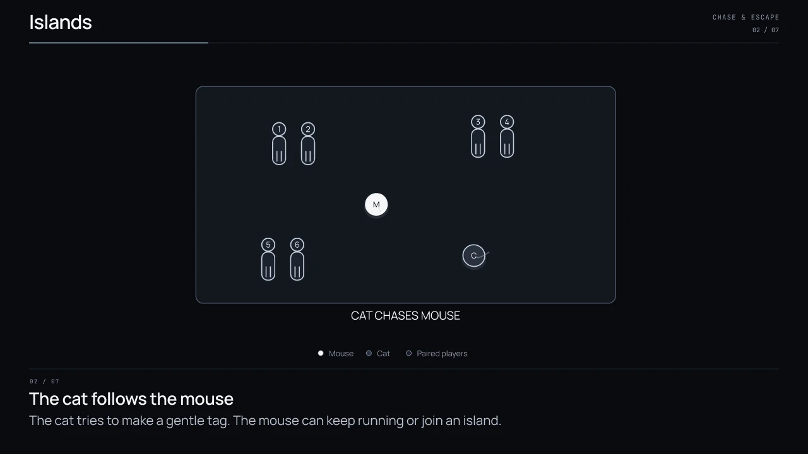

# Group Games

[](https://github.com/mteyra/group-games/actions/workflows/pages.yml) [](LICENSE) [](https://creativecommons.org/licenses/by/4.0/)

**72 short animated films that teach physical group games. Watch the rules happen, then go and play.**

From Islands and Manhunt to Flunkyball and dodgeball variations you only learn from one particular gym teacher: each game is a captioned film that shows the setup, the movement, what each rule changes and how a round ends. No sound or presenter needed.

[Watch the films](https://mteyra.github.io/group-games/) · [Browse the atlas](https://mteyra.github.io/group-games/atlas.html) · [Field guide](https://mteyra.github.io/group-games/field-guide/) · [72-page PDF](site/group-games-field-guide.pdf)



## What's inside

- **72 films** across six families: chase, dodge, target, world, team and together games. Each is a downloadable MP4 with five to seven chapters and captions built into the picture.
- **A film player** with chapters, a transcript, playback speed, full screen and keyboard controls. The next game can start on its own.
- **An atlas** to search by name, place or equipment and filter by family, group size, space and no-equipment games.
- **Your lineup:** save favourites, reorder them, then watch, print or download them as text. It's saved only in your browser.
- **A field guide** with full rules, adaptations and 83 sources, and a printable 72-page PDF.

It's a curated collection, not a complete list of every game in the world or a ranking.

## Quick start

Open the [website](https://mteyra.github.io/group-games/). To run it locally, with Python 3:

```sh
git clone https://github.com/mteyra/group-games.git
cd group-games
npm start        # serves site/ at http://127.0.0.1:8879
```

The finished films are committed, so nothing needs building or installing to serve the site.

## Working on it

With Node.js 22 or newer:

```sh
npm run check    # validate all 72 games and their sources
npm test         # 35 tests: core behaviour, motion, film rendering and timing
```

Pushing to `main` runs both, then deploys `site/` to GitHub Pages. Making new films, the media checks, player controls, URL formats and the file map are in [docs/DEVELOPING.md](docs/DEVELOPING.md).

```
group-games/
├── site/          the website, served as-is
│   ├── index.html · atlas.html · print.html · field-guide.html
│   ├── *.js · *.css
│   ├── data/      the 72 games (three JSON files)
│   └── films/     72 MP4 films, posters and their manifest
├── tools/         film renderer, validators and tests
├── research/      research notes per family + checks/ (verification records)
└── docs/          DEVELOPING.md
```

## License

The code is under the [MIT License](LICENSE). The films, written rules and research notes are under [CC BY 4.0](https://creativecommons.org/licenses/by/4.0/): reuse them with credit to Group Games. Bundled fonts keep their own licenses ([notices](site/assets/fonts/LICENSES.txt)), and each source in the field guide belongs to its publisher.
